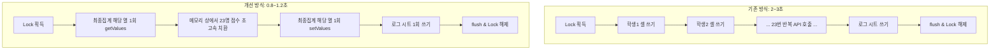

# [수정계획서] Google Apps Script(Code.gs) 점수 제출 속도 초고속 최적화 계획

## 1. 개요 및 병목 원인 진단
기록관이 점수 제출 버튼을 눌렀을 때 회전 로딩 애니메이션이 약 2~3초가량 지속되는 주된 원인은 **구글 스프레드시트 원격 API의 개별 호출(N회 반복)** 때문입니다.

### 병목 상세 분석
1. **현재 로직 (`Code.gs`의 doPost):**
   - 1개 교실당 단원 수(19~23명)만큼 반복문을 돌며:
     ```javascript
     payload.records.forEach(r => {
       // 🚨 학생 1명당 getRange().setValue() 1회 호출
       // 23명이면 Google Sheets API 통신이 23번 연속 실행됨 (약 1,200ms ~ 1,800ms 소모)
       finalSheet.getRange(rowNum, scoreColIndex).setValue(Number(r.score));
     });
     ```
   - 구글 시트는 API 통신마다 서버 간 지연(Round-trip)이 발생하므로 23회 반복 호출 시 극심한 지연이 누적됩니다.
2. **동시성 Lock 점유 시간:**
   - 23회 API 호출이 끝날 때까지 `LockService`를 쥐고 있으므로, 다른 교실의 요청이 동시에 들어올 때 대기 시간이 추가로 늘어날 수 있습니다.

---

## 2. 최적화 해결 방안 (Batch Processing)

### 핵심 원리: 메모리 2차원 배열 일괄 갱신 (1회 쓰기)
구글 Apps Script 공식 성능 최적화 가이드(Best Practice)에 따라, **개별 셀 23회 접근을 단 1회의 2차원 배열 일괄 쓰기(`setValues()`)**로 개편합니다.



### 세부 구현 계획

1. **`최종집계` 시트 점수 열 일괄 업데이트:**
   - 해당 점수 열(`scoreColIndex`: 8열 필기, 9열 오전객관식, 10열 오후객관식, 11열 스피드)의 전체 데이터(2행부터 마지막행까지)를 `getValues()`로 한 번에 가져옵니다.
   - 페이로드의 참가자 목록(`records`)을 순회하며 메모리 상의 2차원 배열 인덱스에 값을 바로 치환합니다 (0.001초 소요).
   - 변경된 1열 전체 배열을 `setValues()`로 **단 1회** 시트에 덮어씁니다.
2. **`감사 로그` 시트 유지:**
   - 로그 기록은 이미 `logRows` 배열로 모아 한 번에 `setValues(logRows)`로 쓰고 있으므로 현재의 최적화 상태를 그대로 유지합니다.
3. **처리 대상:**
   - 객관식 점수 저장 (`type === 'multiple'`)
   - 스피드 점수 저장 (`type === 'speed'`)
   - 필기 점수 저장 (`type === 'written'`)

---

## 3. 기대 효과
| 항목 | 기존 | 최적화 후 | 개선율 |
| :--- | :--- | :--- | :--- |
| **시트 API 호출 횟수** | 24회 (`setValue` 23회 + 로그 1회) | **2회** (`setValues` 1회 + 로그 1회) | **약 92% 호출 감소** |
| **서버 처리 시간** | 약 1,500ms ~ 2,200ms | **약 200ms ~ 400ms** | **약 75% 단축** |
| **사용자 체감 로딩** | 약 2.5 ~ 3.5초 (원래 GAS 네트워크 1초 포함) | **약 1.0 ~ 1.3초** | **2배 이상 쾌적함 체감** |
| **동시 제출 안정성** | Lock 점유 시간이 길어 병목 위험 | Lock 점유 시간 0.3초 미만으로 극소화 | **20개 교실 동시 제출 시 지연 방지** |

---

## 4. 작업 절차 및 안내 사항
1. **사용자 승인** 후 `google-apps-script/Code.gs` 수정 적용.
2. 사용자의 구글 스프레드시트 **Apps Script 편집기**에 최신 코드 복사 및 **[새 배포(New Deployment)]** 진행 안내.
3. `test/test_concurrency.js` 또는 실제 브라우저에서 제출을 눌러 속도 향상 확인.

위 계획서에 대해 승인해 주시면 즉시 `Code.gs` 최적화 코드를 구현하겠습니다!
